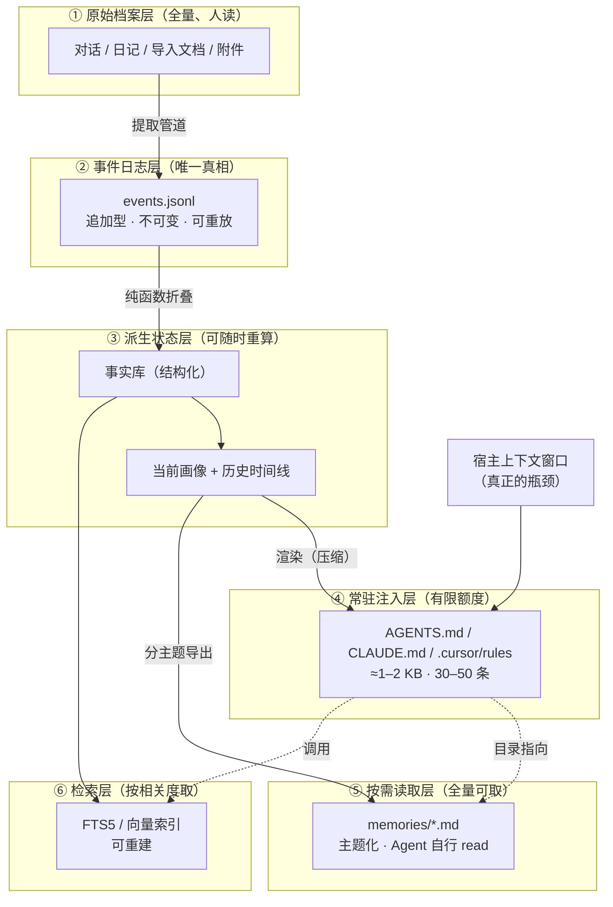

# 存储层次与终局形态

> **性质**：方向性文档，**不是产品规格**，不进入 P0 范围。
> **用途**：回答"记忆到底存在哪、怎么才能被用上"；供 P1 / P2 规格与开源 L0 规范设计引用。
> **状态**：v1.1（2026-11-09，项目更名为 Fasti；网页表单升入 P0）
> **一句话**：**Markdown 是出口，不是仓库。**

---

## 1. 先破除一个误解

> 常见误解："记忆存在 Markdown 里，那能存的东西太有限了。"

实际上，当前架构里**只有 `events.jsonl` 是权威数据**，所有 `.md` 文件都是它的派生视图，删掉后可完整重算。

```
<data-dir>/                      （默认 ~/.fasti）
├── events.jsonl                 ← ★ 权威数据：追加型事件日志，唯一真相
├── profile/
│   ├── current.md               ← 派生：当前画像
│   └── history.md               ← 派生：历史时间线
├── dist/
│   ├── AGENTS.md                ← 派生：注入 DSH / Codex
│   ├── CLAUDE.md                ← 派生：注入 Claude Code
│   └── .cursor/rules/...        ← 派生：注入 Cursor
└── exports/                     ← 派生：导出包
```

**推论**：容量问题不在"存"，而在"一次能塞进上下文多少"。前者几乎无限，后者受上下文窗口约束——这是所有 AI 系统共同的物理限制。

---

## 2. 六层结构

分两组：**存什么**（存储侧三阶）与**怎么用上**（取用侧三阶）。



---

## 3. 每一层是什么

### ① 原始档案层（Raw Archive）

| 项 | 内容 |
|---|---|
| 存什么 | 原始对话、日记、导入的文档与附件 |
| 介质 | 文件系统（按日期/来源分目录），可选索引 |
| 容量 | 仅受磁盘限制，**无产品上限** |
| 生命周期 | 永久保留，除非用户主动删除 |
| 谁用 | 人回看；提取管道作为输入；审计时追溯"这条记忆从哪来" |
| P0 | ❌ 不做 |

**这层是"全量"的，不压缩、不提炼。** 原设计说明书第一条原则"原始数据与提炼记忆分离"指的就是这一层与 ③ 的分工。

### ② 事件日志层（Event Log）—— 唯一真相

| 项 | 内容 |
|---|---|
| 存什么 | 追加型操作事件：录入 / 修订 / 演进 / 纠正 / 删除 / 类别变更 / 审核 / 渲染 |
| 介质 | `events.jsonl`（一行一事件，规范化字节） |
| 容量 | 十万级无压力 |
| 生命周期 | 永久；**只追加，不修改，不删除** |
| 谁用 | 程序（折叠成状态） |
| P0 | ✅ 核心 |

**为什么是事件日志而不是直接存表**：确定性重算（同样的日志 → 同样的画像）、完整审计（谁在何时改了什么）、可回滚（重放到某个位置）。

### ③ 派生状态层（Derived State）

| 项 | 内容 |
|---|---|
| 存什么 | 结构化事实库；当前画像；历史时间线 |
| 介质 | 内存折叠（P0）；可持久化为 SQLite（后期，纯优化） |
| 容量 | 事实数百~数千；历史事件数万 |
| 生命周期 | **可随时删除重算**，不是不可再生数据 |
| 谁用 | 渲染器、导出器、检索器 |
| P0 | ✅ 核心（内存折叠 + `profile/*.md` 派生落地） |

### ④ 常驻注入层（Push / Injection）

| 项 | 内容 |
|---|---|
| 存什么 | 压缩后的画像：身份、技术栈、偏好、当前项目、沟通风格 |
| 介质 | `AGENTS.md` / `CLAUDE.md` / `.cursor/rules`（派生） |
| 容量 | **≈1–2 KB，约 30–50 条事实** ← 用户感知到的"限制"在这一层 |
| 生命周期 | 每次修改后重新渲染 |
| 谁用 | 宿主在会话启动时自动加载 |
| P0 | ✅ 核心 |

**注入点有两个层级**（DSH 的 `dsh-agent-instructions` 机制已实证支持）：

```
① $DSH_HOME/AGENTS.md    （~/.dsh/AGENTS.md）   ← 全局层：关于"我"，所有项目通用
② <项目根>/AGENTS.md                            ← 项目层：关于"这个项目"
```

这正是"无需重复描述有关我或项目的背景"的实现位置。

### ⑤ 按需读取层（Pull / On-demand）

| 项 | 内容 |
|---|---|
| 存什么 | 主题化的记忆文件（技术栈 / 工作经历 / 各项目 / 学习记录 …） |
| 介质 | `memories/*.md`（从状态层分主题导出） |
| 容量 | 全量可取，不占常驻上下文 |
| 生命周期 | 随状态层更新 |
| 谁用 | Agent 通过文件读取工具自行打开 |
| P0 | ❌ 不做，P1 |

**关键设计**：④ 的 2 KB 里除了画像，再放一个**记忆目录**，指向 ⑤ 的文件。Agent 需要时顺着目录自己去读。

### ⑥ 检索层（Retrieval）

| 项 | 内容 |
|---|---|
| 存什么 | 索引（倒排 / 向量），不是新数据 |
| 介质 | SQLite FTS5 + 向量索引 |
| 容量 | 全量可索引 |
| 生命周期 | **可重建**，不作为唯一数据来源 |
| 谁用 | Agent 通过工具调用，从全量里捞相关细节 |
| P0 | ❌ 不做，P3 |

---

## 4. 什么受限、什么不受限

| 问题 | 答案 |
|---|---|
| 能存多少条事实？ | 几乎无限（事件日志十万级） |
| 一次能自动带进上下文多少条？ | **30–50 条（≈2 KB）** ← 真正的限制 |
| 那其余的怎么用上？ | 目录 + 按需读取（⑤）+ 检索（⑥） |
| 原始对话/日记存哪？ | ① 原始档案层，全量，与画像分开 |

**核心结论**：

> **真正的风险不是"存不下"，而是"存了但没被调出来"。**
> 所以系统的价值不在容量，在**分发策略**——什么常驻、什么进目录、什么要检索。

---

## 5. 两条输入管道

| 管道 | 输入 | 产出 | 更新频率 | 为什么这么分 |
|---|---|---|---|---|
| **对话提取** | 与 Agent 的会话记录 | 关于**你**的事实（技术栈、偏好、目标） | 慢 | 个人信息只在对话里出现 |
| **仓库推断** | git log / README / 依赖清单 / 目录结构 | 关于**项目**的背景（在做什么、用到什么、改到哪） | 快 | **代码不会说谎**：对话里说的常是临时任务，仓库反映真实状态 |

推论：**项目背景不应该主要靠对话提取**，而应从仓库推断——更准、更便宜、不需要模型判断。

---

## 6. 终局的一天（剧本）

### 第 0 天 · 一次性安装（约 20 分钟）

1. 扫描本机已有的会话历史（DSH / Claude Code transcript 都在本地）
2. 提议 20–30 条核心事实，用户逐条确认
3. 生成 `~/.dsh/AGENTS.md`（全局画像）

### 每天开工

```
打开 DSH → 选项目目录 → 新会话
  ↓
DSH 自动加载：~/.dsh/AGENTS.md（我是谁）+ <项目>/AGENTS.md（项目背景）
  ↓
用户："把这个接口改成幂等的。"
  ↓
Agent 已知道：技术栈、项目结构、偏好显式错误码、当前在 P0 阶段
  ↓
直接给方案，不询问背景、不举错语言的例子
```

**用户不需要"调用记忆系统"——它在会话开始前就已完成注入。**

### 会话结束

```
后台：读取本次会话 → 提取候选 → 大部分 NOOP
  ├─ 关于"你"的 → 个人画像候选队列
  ├─ 关于"项目"的 → 重新扫描仓库
  ├─ 高置信低影响 → 直接写入
  └─ 冲突 / 重要变化 → 今日审核队列
次日早晨：约 3 分钟审核 3–5 条
```

### 发生变化

```
用户："我们组上个月全面转 Rust 了"
  ↓
记为「演进」（不是覆盖）
  ↓
画像：主力语言 Rust（自 2026-12；此前 Python/C++）
  ↓
下一个会话，所有 Agent 都知道现在用 Rust，也知道以前用 Python
```

### 换 Agent / 换项目

- 打开 Claude Code → 读 `CLAUDE.md`，同一个人在
- 打开 Cursor → 读 rules，同一个人在
- 切到另一个项目 → 只有该项目的 `AGENTS.md`，不串味

---

## 7. 与 P0 的差额

| 能力 | P0 现状 | 终局 |
|---|---|---|
| 事件日志 / 确定性重算 | ✅ | ✅ |
| 个人画像（手工录入） | ✅ | ✅ 自动提取 + 人工审核 |
| 全局 + 项目双层注入 | ✅ 文件渲染 | ✅ 双层落位 |
| 演进 / 纠正区分 | ✅ | ✅ + 自动识别 |
| 项目背景 | ❌ 无 | ✅ 仓库自动推断 |
| 原始档案层 | ❌ 无 | ✅ 全量留存 |
| 按需读取层（⑤） | ❌ 无 | ✅ 记忆目录 + 主题文件 |
| 检索层（⑥） | ❌ 无 | ✅ |
| 审核队列（每日预算） | ❌ 全手工 | ✅ 每日 3–5 条 |
| 图形录入界面 | ✅ 本机网页表单（v3） | ✅ 同上 + 更多视图 |
| 多宿主 | ✅ 三份文件（全局优先接入） | ✅ 任意宿主 + 适配器 |

**P0 已经覆盖了终局里最难沉淀为"架构"的部分**：数据模型、时间语义、渲染、治理。缺的是"喂数据的管道"和"取数据的细节层"。

---

## 8. 三个不粉饰的难点

**① 注入有额度上限。** 全局画像 1–2 KB，项目背景同样。不可能把所有记忆塞进上下文。"无需重复描述"的天花板，取决于能否把"关于你"压缩到 2 KB 以内——这正是"画像"一词的意义：**它不是记忆库，是压缩后的你。**

**② "该不该记"比"能不能记"难得多。** 一句"我今天在调空指针"若被当真记入，会污染画像并注入所有 Agent。所以审核不是可选项，**必须有 review budget 与撤销机制**。这也是 P0 先把版本、历史、回滚打好底子的原因。

**③ 宿主能力参差。** 有的宿主有会话结束 hook（可自动触发提取），有的只能定时扫文件，有的只能手动导入。L2 适配器层必然分质量档次——这是开源必须面对的现实。

---

## 9. 阶段门槛（每一阶段解锁什么）

| 阶段 | 解锁 | 通过门槛 |
|---|---|---|
| **P0** | 手工录入（**本机网页表单**）+ 画像 + 渲染 + 导出导入 | 用户真实使用 4 周，价值判据 V-01~V-06 |
| **P1** | 审核队列 + 按需读取层 + 仓库推断项目背景 | 日均维护 ≤30 分钟且画像持续准确 |
| **P2** | 对话自动提取（先接 1 个宿主）+ 演进自动识别 | 提取 precision ≥ 0.7 |
| **P3** | 检索层 + 多宿主适配器 + 导出对齐 OKF | 检索 Recall@5 达标；两宿主体验一致 |
| **P4** | 沉淀 L0 规范 + 开源发布 | 有外部使用者按规范实现 |

**每一阶段的门槛都是上一阶段的价值验证，不是功能清单。**

---

## 10. 对开源形态的含义

- **L0 规范**：数据模型 + 生命周期 + 治理语义 + 交换格式 ← 真正稀缺
- **L1 参考实现**：核心 + 本地存储 + CLI
- **L2 适配器**：宿主（文件 / MCP / hook）与存储（SQLite / Postgres）
- **L3 应用**：个人画像工具（即本项目的用法示例）

代码谁都能写；**语义被引用才是标准**。
